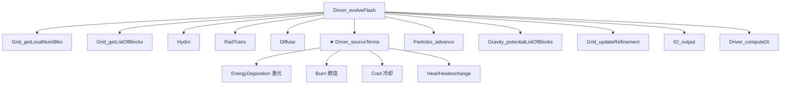

# Driver_evolveFlash — FLASH 主循环

> **状态**：beta | **最后核对**：2026-07-12 | **源码版本**：FLASH 4.8

## 定义位置

| 类型 | 文件:行号 |
|---|---|
| **主实现（Unsplit）** | `source/Driver/DriverMain/Unsplit/Driver_evolveFlash.F90:37` |
| **主实现（Split）** | `source/Driver/DriverMain/Split/Driver_evolveFlash.F90:40` |
| **主实现（multithreaded）** | `source/Driver/DriverMain/multithreaded/Driver_evolveFlash.F90` |
| **主实现（INSfracstep）** | `source/Driver/DriverMain/INSfracstep/Driver_evolveFlash.F90:33` |
| **stub（顶层）** | `source/Driver/Driver_evolveFlash.F90:47` |
| **interface 声明** | `source/Driver/Driver_interface.F90:79` |

setup 时选哪个变体：
- 默认 → Unsplit（用于可压缩 / MHD）
- `+split` → Split（用于燃烧等需要 Strang splitting）
- `multithreaded=true` → multithreaded
- INS 单元 → INSfracstep

## 函数签名

```fortran
subroutine Driver_evolveFlash()    ! 无参数，全靠 use 全局状态
```

## 主循环结构（Unsplit 版）

```fortran
! source/Driver/DriverMain/Unsplit/Driver_evolveFlash.F90:131-138
do dr_nstep = dr_nBegin, dr_nend                                   ! ★ 时间步主循环
   ! ↓ super-time-stepping（可选，加速扩散）
   if (dr_useSTS) call Driver_superTimeStep(...)
   
   ! ↓ 取本 processor 的所有 leaf block
   call Grid_getLocalNumBlks(localNumBlocks)
   call Grid_getListOfBlocks(LEAF, blockList, blockCount)
   
   ! ↓ 1. 主循环内每步打印 + IO 检查（F90:L182-220）
   ! ↓ 2. Hydro 求解（:290-294）
   call Hydro(blockCount, blockList, dr_simTime, dr_dt, dr_dtOld, sweepDummy)
   call Driver_driftUnk(...)              ! 处理 drift block（AMR 动态负载均衡）
   
   ! ↓ 3. 扩散过程：辐射 + 粘性 + 热传导 + 磁阻（:296-303）
   call RadTrans(blockCount, blockList, dr_dt)
   call Diffuse(blockCount, blockList, dr_dt)
   
   ! ↓ 4. ★ sourceTerms —— 包含激光（:307-310）
   call Driver_sourceTerms(blockCount, blockList, dr_dt)
   
   ! ↓ 5. 粒子推进（:320-322）
   call Particles_advance(dr_dtOld, dr_dt)
   
   ! ↓ 6. 重力、AMR 重细化、IO 输出、computeDt（下一步 dt）
   ! ↓ ...
end do
```

## 关键调用关系（mermaid）



## 关键状态变量（来自 `Driver_data` 模块）

| 变量 | 类型 | 含义 |
|---|---|---|
| `dr_nstep` | INTEGER | 当前时间步编号 |
| `dr_nBegin` / `dr_nEnd` | INTEGER | 起始/终止步（从 parfile `nbegin`/`nend` 读） |
| `dr_dt` | REAL | 当前时间步长（CGS 秒） |
| `dr_dtOld` / `dr_dtNew` | REAL | 上一步/下一步 dt |
| `dr_simTime` | REAL | 当前模拟时间 |
| `dr_tmax` | REAL | 模拟终止时间 |
| `dr_globalMe` | INTEGER | 当前 processor ID |
| `dr_globalNumProcs` | INTEGER | 总 processor 数 |
| `dr_restart` | BOOLEAN | 是否从 checkpoint 重启 |

## 常被问到的问题

**Q: 为什么我的模拟只跑 N 步就停了？**
A: 检查 `dr_nEnd`（parfile `nend`）和 `dr_tmax`（parfile `tmax`）。任一满足即停。

**Q: 时间步为什么越来越小？**
A: `Driver_computeDt` 综合各单元的 dt 限制（CFL、扩散、热传导等），取最小。看日志的 dt decomposition。

**Q: 怎么改 sourceTerms 调用顺序？**
A: 不在这个文件，在 `Driver_sourceTerms.F90`。详见 `snippets/driver-source-terms.md`。

## 相关条目

- `snippets/driver-source-terms.md` — sourceTerms 内部调度
- `snippets/grid-get-blk-ptr.md` — block 数据访问
- `flash-driver` skill（待 Phase 2 建）— 完整 Driver 单元讲解

## 跨 skill 引用

- 想了解激光如何被调用 → `flash-laser/knowledge/internals.md §2.1`
- 想了解 Hydro 求解器 → `flash-hydro`（Phase 2）
- 想了解 AMR refinement → `flash-grid`（Phase 2）

## 变更日志

| 日期 | 改动 | 改动人 |
|---|---|---|
| 2026-07-12 | 初始创建（Unsplit 主实现，含 mermaid 调用图） | claude |
